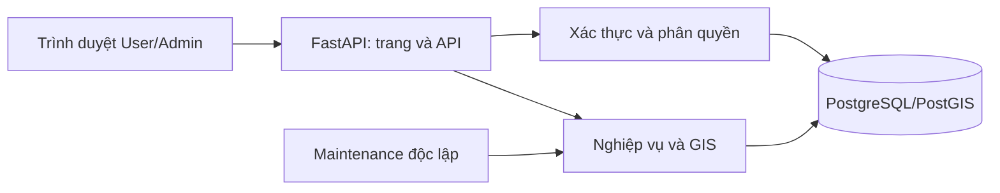
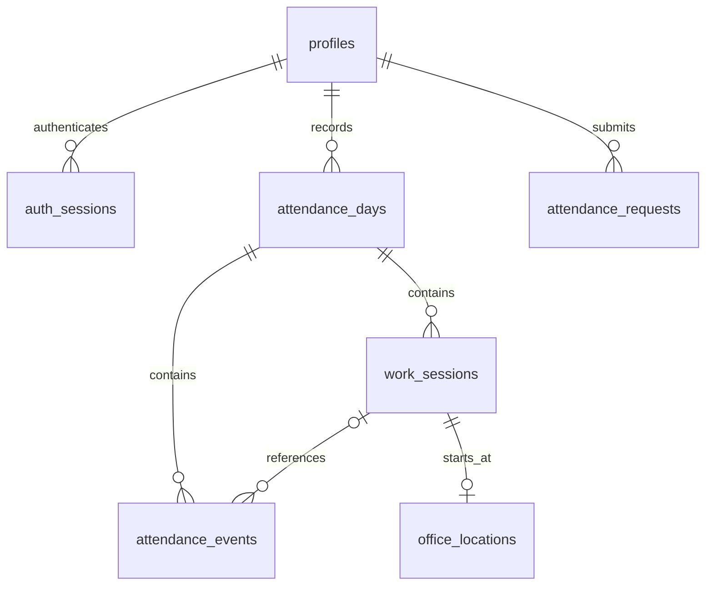

# GeoAttend — Thiết kế MVP, Phase 0

**Ngày:** 14/10/2026. **Trạng thái:** đã được người dùng duyệt qua yêu cầu “tiếp tục” sau bàn giao bản thiết kế. Phase 0 hoàn thành về phân tích và thiết kế; chưa triển khai mã nguồn.

**Nguồn nghiệp vụ:** [BRD](../../../README.md), [roadmap](../../ROADMAP.md), [quy tắc tài khoản](../../ACCOUNT_RULES.md), [bảng chuyển trạng thái](../../STATE_TRANSITIONS.md).

Tài liệu tổng hợp các quyết định đã chốt và đề xuất kỹ thuật để triển khai. Quy tắc nghiệp vụ, lựa chọn kỹ thuật và bổ sung trạng thái dưới đây đã được duyệt làm cơ sở lập kế hoạch từng phase. Chưa có mã nguồn hoặc triển khai dịch vụ trong Phase 0.

## 1. Mục tiêu và giới hạn

- MVP cho một công ty, một văn phòng, một nhóm; khoảng 10 người dùng pilot và một Admin chỉ quản lý.
- User đăng nhập bằng tên tài khoản/mật khẩu do Admin cấp; được dùng ngay mật khẩu được cấp, tự đổi sau; Admin đặt lại khi User quên mật khẩu.
- Ghi nhận Office, Remote, nghỉ trưa, nghỉ sáng/cả ngày; cho bắt đầu lại sau Check-out, hủy nghỉ để làm việc và chuyển trực tiếp Office/Remote.
- Office xác minh vị trí trong hoặc trên ranh giới; không vùng đệm, không chặn theo sai số GPS. Remote cần lý do. Không có GPS cho Check-out hoặc nghỉ.
- Giờ Việt Nam, tự đóng lúc 20:00; không bắt đầu/tiếp tục/chuyển chế độ từ đúng 20:00 đến hết ngày. Nghỉ trưa lúc 20:00 chuyển Check-out mà không kéo dài phiên cũ.
- GPS lưu 30 ngày, sau đó xóa tọa độ/độ chính xác; giữ lịch sử và kết quả xác minh.
- Không phê duyệt nghỉ/Remote, tính lương, đánh giá theo giờ, theo dõi vị trí liên tục, Google login hoặc đăng ký công khai.

## 2. Kiến trúc

**Đã chốt:** FastAPI phục vụ Frontend HTML/CSS/JavaScript và API trên cùng một địa chỉ, PostgreSQL/PostGIS trên Supabase theo BRD.

**Lựa chọn kỹ thuật đã duyệt:**

| Thành phần | Lựa chọn | Trách nhiệm |
| --- | --- | --- |
| Web | FastAPI, HTML/CSS/JavaScript thuần | Phục vụ trang và API; giao diện gọi `/api/...` cùng nguồn. |
| Bản đồ | Leaflet | Polygon, Marker, tên nhân viên và Popup; biên tập Polygon bằng các đỉnh có thể thêm/xóa/kéo và xem trước trước khi lưu. |
| Database | PostgreSQL/PostGIS trên Supabase; Psycopg 3 | Backend kết nối trực tiếp bằng pool và SQL có tham số; xử lý giao dịch, ràng buộc và GIS. |
| Xác thực | Phiên đăng nhập lưu tại database | Backend xác minh tài khoản/mật khẩu; trình duyệt nhận cookie phiên, không truy cập database trực tiếp. |
| Mật khẩu | Argon2id | Chỉ lưu hash mật khẩu. |
| Migration | Các migration SQL đánh số | Tạo schema, ràng buộc, index, phiên bản schema; chạy bằng công cụ quản trị của dự án. |
| Tác vụ | Tiến trình maintenance độc lập, chạy mỗi phút | Đóng ngày, xóa GPS hết hạn và dọn phiên đăng nhập hết hạn; chạy lại không ghi trùng. |
| Kiểm thử | Pytest và database PostGIS thử nghiệm | Kiểm thử API, quyền, transaction, trạng thái, GIS và tác vụ theo thời gian kiểm soát. |



Supabase cung cấp database; xác thực tài khoản thuộc ứng dụng FastAPI. Dữ liệu ứng dụng nằm trong schema riêng `geoattend`, không mở qua API dữ liệu công khai. Tài khoản database chạy ứng dụng chỉ có quyền cần thiết; migration dùng tài khoản riêng. Frontend không nhận thông tin kết nối hoặc khóa quản trị database.

Bản đồ nền lấy URL và attribution từ cấu hình triển khai. Lỗi tải nền không làm mất thao tác chấm công hay dữ liệu; Geofence/Marker vẫn có nguồn riêng từ API.

## 3. Tài khoản và phiên đăng nhập

- Tên đăng nhập chuẩn hóa trim/lowercase, dài 3–50 ký tự, gồm chữ Latin không dấu, số, dấu chấm, gạch dưới hoặc gạch ngang; duy nhất không phân biệt hoa/thường. Họ tên giữ tiếng Việt. Không yêu cầu email trong MVP.
- Mật khẩu dài 8–128 ký tự, không tự trim; kiểm tra cả khi tạo, tự đổi và Admin đặt lại. Hệ thống không lưu/ghi log mật khẩu.
- Khởi tạo Admin bằng lệnh quản trị: nhập bí mật qua prompt ẩn; nếu Admin tồn tại thì dừng, không tạo thêm hoặc tự thay mật khẩu. Database ngăn tài khoản Admin thứ hai bằng unique index có điều kiện.
- Khôi phục Admin bằng lệnh quản trị có quyền truy cập môi trường/database, đặt mật khẩu mới và thu hồi các phiên đăng nhập của Admin; không có API công khai phục hồi Admin.
- Đăng nhập tạo token ngẫu nhiên, chỉ lưu hash token trong `auth_sessions`. CSRF token ngẫu nhiên lưu tại phiên và trả qua login/me; token này chỉ dùng cùng phiên hợp lệ, không thay thế token đăng nhập. Cookie `geoattend_session` có `HttpOnly`, `SameSite=Lax`, `Path=/`, `Secure` khi triển khai HTTPS; hạn phiên tuyệt đối 12 giờ.
- Yêu cầu thay đổi dữ liệu phải có CSRF token gắn với phiên qua header `X-CSRF-Token`; Backend kiểm tra nguồn yêu cầu. Đăng nhập chỉ nhận JSON từ cùng nguồn, kiểm tra Origin khi có và từ chối Origin khác.
- Tự đổi mật khẩu cần mật khẩu hiện tại và mật khẩu mới. Sau đổi/đặt lại, thu hồi toàn bộ phiên đăng nhập của tài khoản bị tác động; người dùng đăng nhập lại. Admin đặt lại cho User không ảnh hưởng phiên của Admin.
- User chỉ thao tác dữ liệu bản thân. Admin tạo/đặt lại tài khoản User, xem trạng thái/lịch sử và quản lý văn phòng; không có quyền chấm công cá nhân hoặc thay đổi chấm công thay nhân viên.
- Không có API sửa vai trò, xóa tài khoản hoặc quản lý nhiều Admin trong MVP. `is_active` phục vụ kiểm tra truy cập và dữ liệu thiết lập, chưa thêm chức năng kích hoạt/khóa tài khoản qua giao diện.
- Thông báo đăng nhập sai không phân biệt tài khoản không tồn tại hay sai mật khẩu; giới hạn 5 lần đăng nhập thất bại/tài khoản đã chuẩn hóa trong 5 phút bằng dữ liệu dùng chung tại Backend, không vô hiệu hóa tài khoản vĩnh viễn.

## 4. Mô hình dữ liệu

Mọi khóa chính dùng UUID, thời điểm dùng `timestamptz`; `work_date` là ngày Việt Nam. Thời gian thực thi do Backend/database xác định, không lấy đồng hồ thiết bị làm giờ nghiệp vụ.

| Bảng | Trường chính | Ý nghĩa và ràng buộc |
| --- | --- | --- |
| `profiles` | `id`, `username`, `full_name`, `password_hash`, `role`, `is_active`, `created_at` | Một Admin; username duy nhất; role chỉ USER/ADMIN. Không lưu email vì MVP không cần. |
| `auth_sessions` | `id`, `user_id`, `token_hash`, `csrf_token`, `expires_at`, `revoked_at`, `created_at` | Phiên đăng nhập, độc lập phiên làm việc. |
| `auth_attempts` | `id`, `username`, `attempted_at` | Chỉ lưu các lần đăng nhập sai phục vụ giới hạn; dọn sau 5 phút, không ghi mật khẩu. |
| `office` | `id`, `name`, `address`, `geom`, `revision`, `updated_at` | Một văn phòng; Polygon EPSG:4326 hợp lệ, có diện tích; `geom` có thể null trước cấu hình, khi đó không cho Office. |
| `attendance_days` | `id`, `user_id`, `work_date`, `status`, `revision`, `updated_at` | Duy nhất `(user_id, work_date)`; trạng thái ngày, dùng khóa hàng khi chuyển trạng thái. Chỉ User có bản ghi. |
| `work_sessions` | `id`, `day_id`, `work_mode`, `start_time`, `end_time`, `start_reason`, `end_reason`, `end_source`, `office_revision` | Phiên Office/Remote; tối đa một phiên mở/ngày và không mở ngày mới khi còn phiên cũ; `end_source` phân biệt USER/SYSTEM. Không lưu tọa độ tại bảng này. |
| `attendance_events` | `id`, `day_id`, `session_id`, `event_type`, `event_time`, `recorded_at`, `source`, `reason`, `location_verified` | Sự kiện lịch sử, session nullable cho nghỉ/kết thúc ngày; tách thời điểm nghiệp vụ và thời điểm thực thi tác vụ. |
| `office_locations` | `id`, `session_id`, `start_event_id`, `point`, `accuracy_m`, `recorded_at`, `expires_at`, `purged_at` | Một vị trí bắt đầu phiên Office; `point` và `accuracy_m` nullable sau xóa; không có vị trí kết thúc. |
| `attendance_requests` | `id`, `user_id`, `request_id`, `payload_hash`, `result_event_ids`, `completed_at` | Duy nhất `(user_id, request_id)`; chống thao tác lặp. Không lưu JSON tọa độ hoặc bản sao phản hồi chứa GPS. |



Index: username, một Admin, `(user_id, work_date)`, phiên đang mở, `(day_id, event_time)`, GPS hết hạn, phiên đăng nhập còn hiệu lực; GiST cho Polygon/Point. Giao dịch chấm công khóa hồ sơ User để tuần tự hóa cả thao tác qua ngày và khóa bản ghi ngày; kiểm tra trạng thái/phiên trước khi ghi.

Các sự kiện: `WORK_START`, `WORK_END`, `LUNCH_START`, `MORNING_LEAVE`, `FULL_DAY_LEAVE`, `LEAVE_CANCELLED`, `DAY_END`. Đóng hệ thống ghi `source=SYSTEM`; đóng phiên do đổi chế độ/nghỉ trưa ghi `source=USER`. Chuyển chế độ có một kết thúc và một bắt đầu tại cùng mốc nghiệp vụ; nghỉ trưa có kết thúc phiên và sự kiện nghỉ.

## 5. Trạng thái và tính nhất quán

Áp dụng toàn bộ bảng chuyển đổi tại [STATE_TRANSITIONS.md](../../STATE_TRANSITIONS.md). Quy tắc mục 3–4 của bảng đã được duyệt cùng tài liệu này:

- Mỗi User có trạng thái theo ngày; nếu ngày mới chưa có sự kiện thì `NOT_STARTED`. Không ghi đè lịch sử ngày trước.
- Chỉ `WORKING_OFFICE`/`WORKING_REMOTE` có phiên mở. Check-out đóng phiên; tạo lại phải tạo phiên mới.
- Hủy nghỉ và bắt đầu là một thao tác kết hợp. Nếu GPS/lý do sai, giữ `FULL_DAY_LEAVE`; không hủy nghỉ trước rồi để thao tác tạo phiên thất bại.
- Chỉ đăng ký nghỉ từ `NOT_STARTED`. Khi đã làm việc và cần kết thúc ngày, dùng Check-out.
- Không tự chuyển `NOT_STARTED`, `MORNING_LEAVE`, `FULL_DAY_LEAVE` sang Check-out lúc 20:00. Chỉ xử lý đang làm việc/nghỉ trưa.
- Cùng mã yêu cầu và cùng nội dung trả kết quả thao tác trước, không ghi lần nữa; khác nội dung trả lỗi xung đột. Kết quả gửi lại dùng ID sự kiện và dựng lại phản hồi với chính sách GPS hiện tại, không phục hồi vị trí hết hạn.
- Client gửi `expected_revision`; sau khi khóa bản ghi, Backend kiểm tra phiên bản rồi mới thay đổi. Màn hình cũ nhận xung đột và tải lại trạng thái.
- Thao tác hợp lệ ghi phiên, sự kiện, trạng thái và mã yêu cầu trong một giao dịch; lỗi bất kỳ hủy toàn bộ. Thao tác không có trong bảng bị từ chối.

## 6. GIS và thời hạn dữ liệu vị trí

- Chỉ gọi `navigator.geolocation.getCurrentPosition` khi người dùng xác nhận thao tác tạo phiên Office; không dùng theo dõi liên tục. Quyền bị từ chối/lỗi không gửi thao tác Office, hiển thị thử lại hoặc chọn Remote.
- Backend kiểm tra latitude [-90,90], longitude [-180,180], giá trị hữu hạn; accuracy không âm và hữu hạn. Sai số lớn vẫn được chấp nhận. Tọa độ không hợp lệ không phải trường hợp sai số lớn.
- Tạo Point bằng thứ tự longitude/latitude, EPSG:4326; dùng `ST_Covers(office.geom, point)` để chấp nhận cả nội vùng và ranh giới. Polygon rỗng/tự cắt hoặc không hợp lệ bị từ chối khi lưu.
- Admin tải Polygon dưới dạng GeoJSON; sửa đỉnh bằng Leaflet, xem trước rồi xác nhận lưu. API dùng `expected_revision` để tránh ghi đè chỉnh sửa mới.
- Thay đổi Geofence chỉ ảnh hưởng xác minh sau đó; không tính lại kết quả của phiên đã bắt đầu. Lưu revision văn phòng đã dùng tại phiên.
- `expires_at = recorded_at + 30 ngày` theo thời điểm tuyệt đối. API luôn che point/accuracy từ đúng thời điểm hết hạn, dù tác vụ dọn chưa chạy.
- Maintenance đặt point/accuracy thành null, giữ bản ghi với `purged_at` để phân biệt GPS hết hạn. Chỉ có một nơi lưu GPS; không sao chép vào sự kiện, mã yêu cầu, log hoặc phản hồi cache.
- Khi khôi phục backup, chạy dọn GPS hết hạn trước mở dịch vụ. Bản sao lưu là dữ liệu vận hành riêng: quy trình triển khai phải nêu vòng đời backup và bảo đảm không đưa GPS hết hạn trở lại API.
- Lịch sử hết hạn hiển thị “Dữ liệu vị trí đã hết hạn lưu”; không có Marker lịch sử. Kết quả xác minh vẫn còn.

## 7. Tự kết thúc ngày và vận hành

- Maintenance chạy mỗi phút, không phụ thuộc trang đang mở, không gắn vào từng worker API. Chuyển trạng thái nghiệp vụ có hiệu lực tại 20:00 giờ Việt Nam.
- Tại hoặc sau mốc 20:00, đóng phiên còn mở với `end_time=20:00`, `end_source=SYSTEM`, sự kiện có `event_time=20:00`, `recorded_at` là thời điểm thực thi. Giao diện ghi rõ đây là mốc hệ thống đóng, không phải giờ kết thúc thực tế.
- Với nghỉ trưa, tạo `DAY_END` và chuyển `CHECKED_OUT`, không sửa phiên cũ hoặc thêm phiên.
- Đọc trạng thái và thao tác chấm công cũng đối soát ngày đã quá hạn trong giao dịch trước trả dữ liệu. Tác vụ chạy trễ/API khởi động lại vẫn xử lý bù ngày cũ trước khi mở phiên mới.
- Sau lấy khóa và ngay trước ghi thay đổi, dùng thời gian thực hiện tại để kiểm tra mốc 20:00. Yêu cầu chờ khóa qua mốc bị từ chối; frontend không có quyền vượt giới hạn.
- Tác vụ và Check-out đồng thời sử dụng cùng khóa và kiểm tra trạng thái nên chỉ có một lần đóng hợp lệ. Không tạo hai sự kiện tự kết thúc ngày.
- Lưu trữ lâu dài lịch sử phiên/sự kiện trong MVP; không thêm chức năng xóa lịch sử cá nhân.

## 8. Hợp đồng API mức thiết kế

Mọi timestamp dùng ISO 8601 có múi giờ; `work_date` dạng YYYY-MM-DD. Người dùng lấy từ phiên xác thực, không nhận `user_id` tùy ý trong API cá nhân. API thành công trả JSON; lỗi dạng `{code, message}` với thông báo tiếng Việt.

| API | Quyền | Dữ liệu và kết quả chính |
| --- | --- | --- |
| `POST /api/auth/login` | Công khai, giới hạn thử sai | `{username, password}` → cookie, thông tin id/họ tên/vai trò và CSRF token. |
| `GET /api/auth/me` | Đã đăng nhập | Thông tin tài khoản và CSRF token; không trả hash/token phiên. |
| `POST /api/auth/logout` | Đã đăng nhập | Thu hồi phiên hiện tại và xóa cookie. |
| `POST /api/auth/change-password` | Đã đăng nhập | `{current_password, new_password}` → thu hồi các phiên, đăng nhập lại. |
| `GET /api/attendance/status` | User | Trạng thái ngày hiện tại, revision, phiên mở, giờ Backend và các thao tác hợp lệ. |
| `POST /api/attendance/actions` | User | `request_id`, `expected_revision`, `action`, dữ liệu theo thao tác → trạng thái mới, revision, ID phiên/sự kiện. |
| `GET /api/attendance/history` | User | `from`, `to`, `page`, `page_size` → Timeline bản thân; mặc định 7 ngày, page_size=20, tối đa 100. |
| `GET /api/admin/users` | Admin | Danh sách User gồm id, username, full_name; không có mật khẩu. |
| `POST /api/admin/users` | Admin | `{username, full_name, password}` → tạo User; không nhận role từ client. |
| `POST /api/admin/users/{id}/reset-password` | Admin | `{new_password}` → đặt lại cho User, thu hồi phiên đăng nhập của User đó. |
| `GET /api/admin/dashboard` | Admin | Snapshot trạng thái hiện tại, tổng số User và danh sách; tách hai loại nghỉ, gồm chưa bắt đầu; có `as_of`. |
| `GET /api/admin/onsite` | Admin | User đang Office, vị trí phiên mở đã xác minh, tên, giờ Check-in; có `as_of`. |
| `GET /api/admin/users/{id}/history` | Admin | Timeline User được chỉ định; phân trang như lịch sử cá nhân. |
| `GET /api/admin/office` | Admin | Văn phòng, Polygon GeoJSON và revision. |
| `PUT /api/admin/office` | Admin | `{name, address, geom, expected_revision}` → cập nhật thông tin/Polygon hợp lệ. |
| `GET /api/health` | Công khai | Tình trạng dịch vụ/database, không lộ cấu hình kết nối. |

Các action: `START_OFFICE`, `START_REMOTE`, `START_LUNCH`, `CHECK_OUT`, `LEAVE_MORNING`, `LEAVE_FULL_DAY`, `SWITCH_OFFICE`, `SWITCH_REMOTE`, `CANCEL_LEAVE_START_OFFICE`, `CANCEL_LEAVE_START_REMOTE`. Các trạng thái khởi đầu hợp lệ theo bảng chuyển trạng thái; tiếp tục sau nghỉ dùng START tương ứng.

Dữ liệu bổ sung: action tạo Office có `{latitude, longitude, accuracy_m}`; Remote/nghỉ có `reason` trim, dài 1–1000 ký tự; Check-out có reason tùy chọn. Không chấp nhận GPS cho action Remote/nghỉ/Check-out. Lý do không chứa HTML được thực thi, hiển thị bằng text.

Mã phản hồi: 401 chưa xác thực, 403 sai quyền hoặc CSRF/ngoài Geofence, 409 xung đột trạng thái/revision/username/request_id hoặc đã qua 20:00, 422 dữ liệu sai, 429 quá số lần thử sai, 503 database/dịch vụ không sẵn sàng. Frontend hiển thị message, không suy luận chỉ từ mã HTTP.

## 9. Màn hình và thao tác

| Màn hình | Nội dung | Luồng chính |
| --- | --- | --- |
| Đăng nhập | Tên tài khoản, mật khẩu, lỗi đăng nhập | Đăng nhập rồi điều hướng theo vai trò; hỗ trợ điện thoại. |
| User hôm nay | Tên, trạng thái, phiên hiện tại, các nút hợp lệ, Timeline ngắn | Chọn Office/Remote/nghỉ, nghỉ trưa, Check-out, chuyển chế độ hoặc hủy nghỉ để làm việc. Hộp nhập lý do/GPS theo thao tác. |
| User lịch sử | Khoảng ngày, Timeline, nguồn kết thúc USER/SYSTEM | Xem phiên và nghỉ; nhãn hết hạn GPS hoặc tự đóng hệ thống rõ ràng. |
| Tài khoản | Đổi mật khẩu cá nhân, đăng xuất | Nhập mật khẩu hiện tại/mới; thành công quay về đăng nhập. |
| Admin Dashboard | Các nhóm trạng thái, danh sách User, bản đồ Onsite, `as_of` | Click Marker/danh sách để xem chi tiết lịch sử. Admin không có nút chấm công. |
| Admin tài khoản User | Danh sách, tạo tài khoản, đặt lại mật khẩu | Admin nhập thông tin và cấp cho nhân viên; không xem lại mật khẩu cũ. |
| Admin văn phòng | Tên/địa chỉ, bản đồ Polygon, chỉnh đỉnh, xem trước, lưu | Hiển thị lỗi Polygon/xung đột, giữ chỉnh sửa chưa lưu khi lỗi. |

Phác thảo User: **trạng thái hôm nay → các thao tác hợp lệ → Timeline → lịch sử/tài khoản**. Phác thảo Admin: **thẻ số lượng → danh sách trạng thái + bản đồ → lịch sử nhân viên**, điều hướng đến **tài khoản User / văn phòng / tài khoản cá nhân**.

Dashboard và bản đồ làm mới mỗi 30 giây khi trang đang hiển thị; làm mới ngay khi quay lại trang hoặc bấm tải lại. Hiển thị thời điểm snapshot; dữ liệu cũ do lỗi mạng phải có nhãn, không thể hiện như trạng thái mới. Làm mới dữ liệu không lấy GPS.

## 10. Cấu trúc triển khai

```text
app/
  main.py                  # Gắn router, phục vụ trang và file tĩnh
  config.py                # Cấu hình môi trường
  db/                      # Pool kết nối, giao dịch và truy vấn theo module
  auth/                    # Xác thực, phiên đăng nhập và đổi mật khẩu
  accounts/                # Admin cấp tài khoản/đặt lại mật khẩu
  attendance/              # Trạng thái, phiên làm việc, sự kiện và API cá nhân
  gis/                     # Polygon, Point và xác minh Office
  admin/                   # Dashboard, Onsite, lịch sử và văn phòng
  maintenance/             # Tự đóng ngày, xóa GPS và dọn phiên đăng nhập
  static/                  # HTML/CSS/JS; tách màn hình và module API/bản đồ
migrations/                # Migration SQL đánh số
scripts/                   # Lệnh migrate, khởi tạo/khôi phục Admin, maintenance
tests/                     # Unit/API/integration PostGIS
```

Sửa cấu trúc thực tế theo kế hoạch từng phase; không dựng toàn bộ module rỗng chỉ để khớp sơ đồ. Chốt phiên bản phụ thuộc và lockfile khi lập kế hoạch Phase 1.

## 11. Kiểm chứng và phân rã thực hiện

- Phase 1: xác thực, một Admin, cấp/đổi/đặt lại mật khẩu; kiểm thử session, CSRF, giới hạn thử sai và quyền User/Admin (AC-01, AC-17–19).
- Phase 2: phiên Remote, lịch sử cá nhân, trạng thái ngày, mã yêu cầu, transaction, tác vụ 20:00 và phục hồi sau downtime (AC-03, AC-06, AC-11–12).
- Phase 3: Office, Polygon, điểm trong/ngoài/trên ranh giới, lỗi GPS, đúng thứ tự tọa độ và xóa GPS sau 30 ngày bằng clock kiểm soát (AC-02, AC-09, AC-16).
- Phase 4: nghỉ, kết thúc nghỉ trưa lúc 20:00, hủy nghỉ, chuyển Office/Remote; thất bại không đóng phiên/hủy nghỉ trước (AC-04–05, AC-13–14).
- Phase 5: Dashboard/Onsite, tổng hợp User, chưa bắt đầu, loại Admin, Popup, nhãn vị trí hết hạn, chỉnh tên/địa chỉ và Geofence (AC-07–08, AC-15).
- Phase 6: mọi AC-01–19 đạt; pilot khoảng 10 người dùng/5 ngày làm việc, không còn lỗi mất dữ liệu/trùng phiên/sai quyền; ít nhất 95% yêu cầu API xử lý tại Backend trong tối đa 2 giây, không tính lấy GPS và mạng.
- Kiểm thử dùng database riêng; không xóa dữ liệu pilot/production để chạy kiểm thử. Migration được kiểm chứng trên database mới.

Phase 0 đã hoàn thành sau khi người dùng duyệt tài liệu. [Kế hoạch Phase 1](../plans/2026-10-14-phase-1-foundation-auth.md) được lập riêng và chờ duyệt trước thực hiện; các phase sau có kế hoạch riêng, giữ nguyên các hợp đồng đã thống nhất.

## 12. Tài liệu công nghệ đã đối chiếu

- [FastAPI phục vụ file tĩnh](https://fastapi.tiangolo.com/tutorial/static-files/).
- [Supabase hỗ trợ PostGIS](https://supabase.com/docs/guides/database/extensions/postgis).
- [PostGIS ST_Covers: kiểm tra cả nội vùng và ranh giới](https://postgis.net/docs/ST_Covers.html).
- [Leaflet: Polygon, Marker, Popup và sự kiện bản đồ](https://leafletjs.com/reference.html).
- [FastAPI: xác minh và hash mật khẩu](https://fastapi.tiangolo.com/tutorial/security/oauth2-jwt/). Bản thiết kế chọn phiên cookie tại database; không áp dụng JWT mẫu trong tài liệu này.
- [Psycopg: truy vấn và transaction](https://www.psycopg.org/psycopg3/docs/basic/usage.html).
